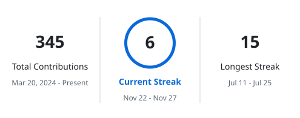

<h1 align="center">Hi, I'm Ilham.</h1>

  <strong>Turning ideas into projects for the web.</strong>

GitHub activity

  <!-- Generated by .github/scripts/contrib-card.mjs in the snake.yml workflow. -->
  <a href="https://github.com/Oqexip">
    <picture>
      <source media="(prefers-color-scheme: dark)" srcset="https://raw.githubusercontent.com/Oqexip/Oqexip/output/contribution-stats-dark.svg">
      <source media="(prefers-color-scheme: light)" srcset="https://raw.githubusercontent.com/Oqexip/Oqexip/output/contribution-stats.svg">
      
    </picture>
  </a>

Contribution activity

  <!-- Generated by the existing .github/workflows/snake.yml workflow. -->
  <picture>
    <source media="(prefers-color-scheme: dark)" srcset="https://raw.githubusercontent.com/Oqexip/Oqexip/output/github-contribution-grid-snake-dark.svg">
    <source media="(prefers-color-scheme: light)" srcset="https://raw.githubusercontent.com/Oqexip/Oqexip/output/github-contribution-grid-snake.svg">
    
  </picture>

  Curious about what I'm building? <a href="https://github.com/Oqexip?tab=repositories">Take a look around.</a>

