<!--
  root@ilham-server:~$ ./ilham --info

  Both cards on this page are SVGs drawn every hour by the snake.yml workflow,
  straight from the GitHub API: profile-card.mjs for the header and
  contrib-card.mjs for the year of light. No third-party widgets.
-->

<a href="https://www.oqexip.site">
  <picture>
    <source media="(prefers-color-scheme: dark)" srcset="https://raw.githubusercontent.com/Oqexip/Oqexip/output/profile-dark.svg">
    <source media="(prefers-color-scheme: light)" srcset="https://raw.githubusercontent.com/Oqexip/Oqexip/output/profile.svg">
    
  </picture>
</a>

 

## Selected work

Each project sits on one layer of the schematic above.

| Layer | Project | Stack | Engineering notes |
| :-- | :-- | :-- | :-- |
| <code>U1</code>&nbsp;Interface | **[Porto](https://github.com/Oqexip/Porto)** | Next.js · TypeScript | My portfolio. Its public `/analytics` page reads Vercel Web Analytics on the server, caches for five minutes, and shows an empty state rather than sample numbers. [Live&nbsp;↗](https://www.oqexip.site) |
| <code>U1</code>&nbsp;Interface | **[EasyVert](https://github.com/Oqexip/EasyVert)** | React · Vite · ffmpeg.wasm · pdf-lib | Converts PDF, Office, image and media files entirely in the browser, so nothing is ever uploaded. [Live&nbsp;↗](https://easyvert.vercel.app) |
| <code>U1</code>&nbsp;Interface | **[Asterism](https://github.com/Oqexip/Asterism)** | JavaScript · Canvas | An interactive star atlas. Chain stars into your own constellations, navigate by keyboard, and keep your figures in local storage. No build step. |
| <code>U2</code>&nbsp;Server | **[OmongIn](https://github.com/Oqexip/OmongIn)** | Laravel 12 · Tailwind | Anonymous discussion boards with threads, nested replies and voting. Middleware lets guests take part through tracked sessions, no account needed. |
| <code>U2</code>&nbsp;Server | **[LSP E-Ticketing](https://github.com/Oqexip/LSP_E-Ticketing)** | Laravel · Blade | Ticket booking with schedules and transactions, plus an admin side for bookings and reports. |
| <code>U3</code>&nbsp;Vision | **[handTracking](https://github.com/Oqexip/handTracking)** | Python · OpenCV · MediaPipe | Frame a "portal" with both hands. MediaPipe tracks four fingertips and one of 11 real-time filters renders inside the frame, with selfie segmentation for the effects that need it. |
| <code>U4</code>&nbsp;Device | **[tetrisNano](https://github.com/Oqexip/tetrisNano)** | C++ · Arduino Nano | Tetris on an upright 8×32 MAX7219 LED matrix, with joystick input, an I²C OLED scoreboard and a buzzer melody. |
| <code>U4</code>&nbsp;Device | **[Sedia Aku Sebelum Banjir](https://github.com/Oqexip/sediaAkuSebelumBanjir)** | C++ · ESP32 · MQTT | Flood early warning. It reads an ultrasonic sensor every 200 ms; below 20 cm it sounds a siren, locks two servos and alerts Telegram, while MQTT telemetry feeds a local web dashboard. |

 

## A year of light

  <!-- Generated by .github/scripts/contrib-card.mjs in the snake.yml workflow. -->
  <a href="https://github.com/Oqexip">
    <picture>
      <source media="(prefers-color-scheme: dark)" srcset="https://raw.githubusercontent.com/Oqexip/Oqexip/output/contribution-sky-dark.svg">
      <source media="(prefers-color-scheme: light)" srcset="https://raw.githubusercontent.com/Oqexip/Oqexip/output/contribution-sky.svg">
      
    </picture>
  </a>

Every day I commit, a star lights up. Consecutive days are joined into a constellation, so a streak is literally something I draw. The numbers come straight from the GitHub API every hour, not from a cached third-party card.

 

  <a href="https://www.oqexip.site">Portfolio</a>
  &nbsp;·&nbsp;
  <a href="https://github.com/Oqexip?tab=repositories">All repositories</a>
    
  <i>Fullstuck developer. No bugs, only features.</i>

