<!--
  root@ilham-server:~$ ./ilham --info

  Both cards on this page are SVGs drawn every hour by the snake.yml workflow,
  straight from the GitHub API: profile-card.mjs for the header and
  contrib-card.mjs for the year of light. No third-party widgets.
-->

<a href="https://www.oqexip.site">
  <picture>
    <source media="(prefers-color-scheme: dark)" srcset="https://raw.githubusercontent.com/Oqexip/Oqexip/output/profile-dark.svg">
    <source media="(prefers-color-scheme: light)" srcset="https://raw.githubusercontent.com/Oqexip/Oqexip/output/profile.svg">
    
  </picture>
</a>

 

## A year of light

  <!-- Generated by .github/scripts/contrib-card.mjs in the snake.yml workflow. -->
  <a href="https://github.com/Oqexip">
    <picture>
      <source media="(prefers-color-scheme: dark)" srcset="https://raw.githubusercontent.com/Oqexip/Oqexip/output/contribution-sky-dark.svg">
      <source media="(prefers-color-scheme: light)" srcset="https://raw.githubusercontent.com/Oqexip/Oqexip/output/contribution-sky.svg">
      
    </picture>
  </a>

Every day I commit, a star lights up. Consecutive days are joined into a constellation, so a streak is literally something I draw.

 

  <a href="https://www.oqexip.site">Portfolio</a>
  &nbsp;·&nbsp;
  <a href="https://github.com/Oqexip?tab=repositories">All repositories</a>

